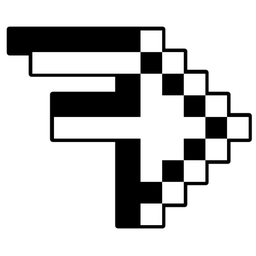
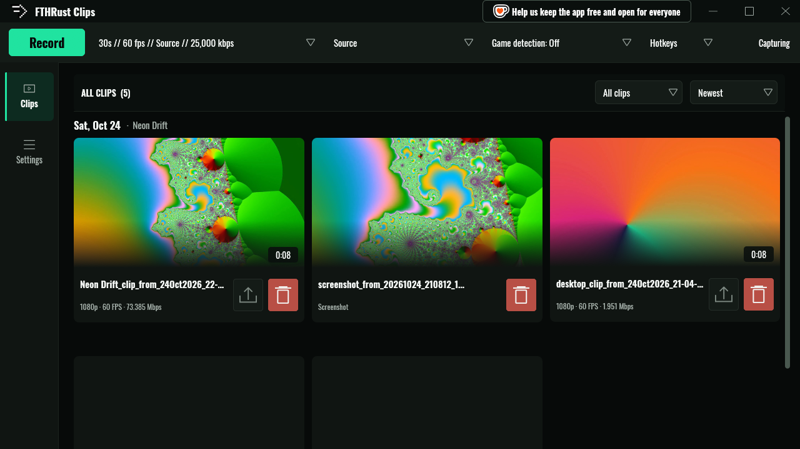
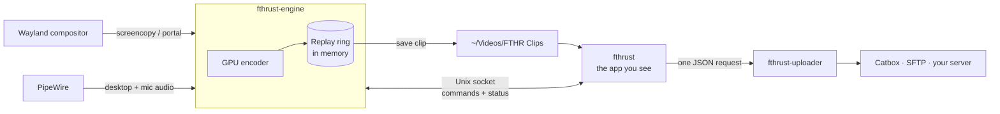

<div align="center">



# FTHRust Clips

**Instant replay for Linux gaming. Native Wayland, written in Rust.**

Hit a key and the last 30 seconds are saved. Trim the clip, crop it, grade it, squeeze it under Discord's size limit and share the link, all without leaving the app.

[](https://github.com/kalopsia-space/FTHRust/actions/workflows/ci.yml)
[](LICENSE)


[Quick start](#quick-start) · [What you get](#what-you-get) · [How it works](#how-it-works) · [Docs](docs/README.md) · [Development](docs/development.md)

<br>



</div>

> FTHRust Clips is a ground-up Rust rewrite of the FTHR Clips Linux app. It reads the same `~/.fthr` settings, so you can switch over and keep your clips, hotkeys and presets. This is a personal project and not an official FTHR Community release.

---

## Why this exists

Recording on Linux usually means OBS, a replay-buffer plugin and a pile of scene setup just to grab one good moment. FTHRust Clips is the "it's always running, press F9" app instead:

- **It's always ready.** The last stretch of gameplay sits encoded in memory. Nothing touches your disk until you save.
- **It's light.** Frames go straight from the compositor to your GPU's hardware encoder. A saved clip is a copy of packets that are already encoded, so saving is near-instant and capture never stops.
- **It's native.** Built for Wayland from the first line. No X11 fallback, no XWayland tricks, no Electron.
- **It finishes the job.** Editing, exporting, size-targeted sharing and uploading all live in the same window as the library.

## What you get

| | |
|---|---|
| **Instant replay** | A rolling buffer from 5 seconds to 15 minutes. One key saves it, and you can add extra keys for other lengths ("last 2 minutes" on F10). |
| **Full recording** | Start and stop long recordings with their own quality settings, with automatic stops before your disk runs out. |
| **Screenshots** | F12 saves a PNG through your desktop's screenshot portal, straight into the library. |
| **Hardware encoding** | NVIDIA NVENC, VA-API (AMD and Intel) and Quick Sync, each tested at startup with a real encode. H.264, HEVC and AV1. |
| **A library you'll actually use** | Clips grouped by day with thumbnails, filters, inline rename, and imports of the folders you already have. |
| **A real clip editor** | Split, delete and restore segments, crop, stretch, change speed, colour-grade, mix audio. Nothing is ever overwritten: edits are drafts until you export. |
| **Share without thinking** | One-click export to a Discord-ready 10 MB file, your own presets, or full-quality and lossless MKV. |
| **Uploads, kept separate** | Optional Catbox, SFTP or your own server, in a separate program that the main app never links. |
| **Overlays** | Burn in a webcam picture-in-picture, image layers, a keyboard overlay, or let Gary react to your microphone. |
| **Make it yours** | Themes with your own fonts, colours, icons and sounds, plus a performance preset for older PCs. |

## Quick start

You need a Wayland desktop on x86_64 Linux with glibc 2.35 or newer (Ubuntu 22.04 and anything later), PipeWire, and a working `xdg-desktop-portal`. Hyprland is the main target. [Installing](docs/install.md) covers other desktops.

**1. Download and run.** Grab `FTHRust-<version>-x86_64.AppImage` from the [releases page](https://github.com/kalopsia-space/FTHRust/releases), then:

```sh
chmod +x FTHRust-*-x86_64.AppImage
./FTHRust-*-x86_64.AppImage
```

**2. Check the status.** The top-right corner of the toolbar should say **Capturing**. Your replay buffer is now filling.

**3. Save a clip.** Play something, then press **F9**. On Hyprland the hotkeys are set up for you; on other desktops see [Hotkeys](docs/capturing.md#hotkeys). Your clip appears in the library and lands in `~/Videos/FTHR Clips`.

**4. Make it shareable.** Click the clip to open the editor. Split out the bit you want, delete the rest, then hit **Share clip** for a Discord-sized file.

That's the whole loop. [Capturing](docs/capturing.md) has the details behind each step.

## How it works



FTHRust Clips runs as two processes. The **engine** captures your screen and audio, encodes them on the GPU and keeps the encoded packets in a ring in memory. The **app** is the window you see; it starts the engine, talks to it over a private Unix socket, and restarts it if it ever falls over. Saving a clip copies the last N seconds of the ring into an MP4 with no re-encode, which is why it's fast.

Uploading lives in a third program, `fthrust-uploader`, which the app runs once per upload. The networking and keyring code for Catbox, SFTP and custom servers only exists in that binary, and CI fails if it leaks into the other two.

[Architecture](docs/architecture.md) goes deeper.

## Documentation

**Using the app**

| Guide | What's in it |
|---|---|
| [Installing](docs/install.md) | Requirements, the AppImage, desktop support, coming from FTHR Clips. |
| [Capturing](docs/capturing.md) | Replay, recording, screenshots, hotkeys, sources, audio, quality and encoders, game detection. |
| [Library and editor](docs/library-and-editor.md) | Browsing clips, the editor, exporting and sharing. |
| [Overlays](docs/overlays.md) | Webcam, image layers, keyboard overlay, Gary, the capture card. |
| [Uploading](docs/uploads.md) | Catbox, SFTP and your own server, plus what each one stores. |
| [Settings](docs/settings.md) | Every settings tab, shortcuts, themes, and the files the app keeps. |
| [Troubleshooting](docs/troubleshooting.md) | Error codes, logs, diagnostic reports, common fixes. |

**Working on FTHRust**

| Guide | What's in it |
|---|---|
| [Development](docs/development.md) | Building, testing, the UI test bench, CI. |
| [Architecture](docs/architecture.md) | Crates, processes, the engine protocol, design rules. |
| [Packaging](docs/packaging.md) | How the AppImage is built, gated and released. |

## Status

FTHRust Clips is an **alpha** (`2.0.0-alpha.1`). The core loop of capture, save, edit, export and upload is complete and covered by about 930 tests plus scripted runs of the real app. Some features are still partly wired; [Capturing](docs/capturing.md#whats-not-there-yet) lists them honestly. Hyprland on x86_64 is the tested setup. Other Wayland desktops should work, with the gaps described in [Installing](docs/install.md#desktop-support).

Found a bug? Export a diagnostic report (**Settings → General → Troubleshooting**) and [open an issue](https://github.com/kalopsia-space/FTHRust/issues).

## License

[GPL-3.0-only](LICENSE). The AppImage bundles an LGPL build of FFmpeg; [THIRD_PARTY_NOTICES.md](THIRD_PARTY_NOTICES.md) lists every bundled component and its licence. Oswald is under the SIL Open Font License.
