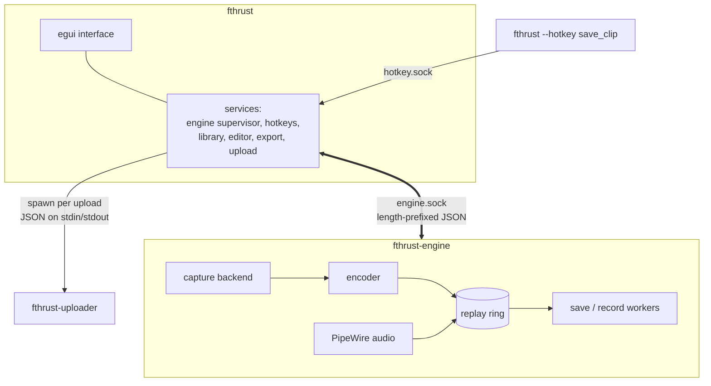
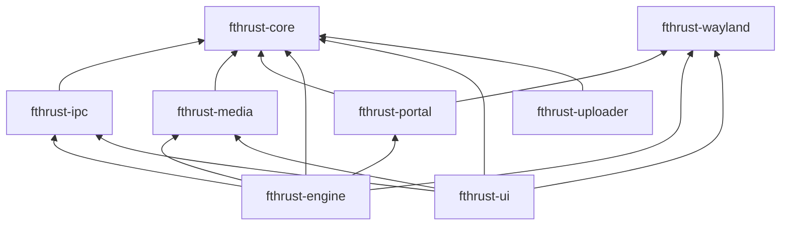

# Architecture

How FTHRust Clips is put together: three processes, eight crates, and the rules that keep them apart.

- [Three processes](#three-processes)
- [Crates](#crates)
- [The engine](#the-engine)
- [The engine protocol](#the-engine-protocol)
- [Engine supervision](#engine-supervision)
- [Hotkey delivery](#hotkey-delivery)
- [The uploader](#the-uploader)
- [Design rules](#design-rules)

## Three processes

| Process | Does | Lives |
|---|---|---|
| **`fthrust`** | The window: library, editor, settings, export queue, overlays. Owns the settings and supervises the other two. | For the whole session. One instance per user. |
| **`fthrust-engine`** | Screen and audio capture, encoding, the replay ring, saving clips and recordings. | Started and restarted by the app. Exits if the app goes away. |
| **`fthrust-uploader`** | All network and keyring code. Handles exactly one request, then exits. | Seconds to minutes, once per upload or connection test. |

Why split them? Capture has to keep running smoothly while the interface does heavy work, like decoding previews, rendering exports or laying out a big library. If the engine crashes, the app notices and restarts it without losing your window. The uploader is split out so the main app can promise it contains no network code at all.

## Crates

| Crate | Role |
|---|---|
| **`fthrust-core`** | Everything stored on disk and the logic around it: settings and their migrations, presets, hotkeys (including the Hyprland config writer), the library scan, clip metadata, clip naming, editor and export models, upload settings and validation, diagnostics and redaction, and paths. All of it stays byte-compatible with the original FTHR Clips `~/.fthr` files. No I/O beyond the filesystem. |
| **`fthrust-ipc`** | The app ↔ engine protocol: message types, framing, the socket transport, and engine config normalisation. `#![forbid(unsafe_code)]`. |
| **`fthrust-media`** | The FFmpeg layer, via `ffmpeg-next`: encoders and encoder choice, startup capability probing, the encoded-packet ring, the clip writer and transactional saves, recording, export rendering, playback and preview decoding, thumbnails, camera input. |
| **`fthrust-wayland`** | Wayland protocol clients: `ext-image-copy-capture` and `wlr-screencopy` capture, output and toplevel lists, layer-shell surfaces for overlays, shared memory buffers. |
| **`fthrust-portal`** | The ScreenCast portal session (through `ashpd`), its PipeWire video stream, and the restore token. |
| **`fthrust-engine`** | The `fthrust-engine` binary: the daemon loop, backend selection and recovery policy, the content watchdog, PipeWire audio, device listing, and the save and record workers. |
| **`fthrust-ui`** | The `fthrust` binary: the egui app on a winit + wgpu runner, every page, popup and dialog, the editor, and the services that talk to the engine, the uploader, portals and the compositor. Also the fidelity markers and the widget dump the test bench reads. |
| **`fthrust-uploader`** | The `fthrust-uploader` binary: Catbox and custom-server HTTP (`reqwest`), SFTP (`russh`), and the Secret Service keyring. |

## The engine

**Capture.** On start, the engine picks a backend: `ext-image-copy-capture` first, then `wlr-screencopy`, then the ScreenCast portal. When capture fails it retries the last working backend first, backing off 250 ms, 750 ms and 1.5 s. Recovery never switches to the portal, and when the portal was the one capturing it re-opens it restore-only: the saved restore token, never the dialog (no token, or a portal that does not restore within 3 s, stops capture). A session the desktop closed ("Stop sharing") is final, like a dismissed picker. The dialog only comes up for a capture the user started: an engine the app restarts on its own (after a crash or hang, for game detection, or to bring back the clips profile after a recording) is told so (`automatic_start` in its `Configure`) and opens the portal restore-only from its first attempt, stopping with `CAPTURE_NOT_RESTORED` if the portal would have to ask. A watchdog samples the picture once a second; twelve black-like or uniform samples in a row set `CONTENT_SUSPECT` and, on `ext-image-copy-capture` and `wlr-screencopy`, restart capture once, and not again until the picture has looked normal. A restart taken during zero-copy capture runs the next generation through shared memory, since a compositor that completes frames into the surfaces without drawing would bring the same black picture back. On the portal the content is only flagged: a restart there is a new ScreenCast session, which could bring the dialog back. With the two Wayland protocols the engine asks the compositor for a frame only when the next one is due at the configured frame rate, so a 60 fps capture of a 144 or 240 Hz monitor costs 60 copies a second, not one per refresh. The portal's PipeWire stream delivers at the rate the compositor chooses, and each frame it delivers is copied once.

**Encoding.** Frames go to a hardware encoder chosen by `fthrust-media::encoder_policy`: NVENC, then VA-API (and AMF), then Quick Sync, or software only when the user explicitly asks for it. Which encoders actually work is decided at app startup by test-encoding one frame with each, in a child process with a 5-second timeout, and cached in `~/.fthr/encoder_capabilities.json`. On VA-API, colour conversion (BGRA to NV12, plus any scaling) runs on the GPU through a `scale_vaapi` filter graph; every other encoder, or a VA-API driver that refuses it, converts on the CPU with swscale, split into slices on half the cores (at most four threads). `FTHR_CPU_COLOR_CONVERT=1` forces the CPU path. Upright BGRX frames are encoded straight from the capture buffer without a copy. With ext-image-copy-capture on the encoder's own GPU (Hyprland), capture is zero-copy: the engine exports four BGRX VA surfaces as dmabufs, the compositor renders each frame into one, and the encoder converts it on the GPU, so the CPU never touches a pixel. The VA surface pools that uploads fill are only created when a frame is first uploaded into them, and go when frames start coming from the exported surfaces, so zero-copy capture holds none once its first frame arrives (the shared-memory frames before it, while the compositor fills the first surface, create one briefly). Otherwise, or if that fails (including a compositor that takes the surfaces but fills none of them for 5 seconds, or fails its first capture into them), frames come through shared memory without restarting capture (`zero-copy capture unavailable; copying frames` in the log says why); `FTHR_NO_ZERO_COPY=1` forces the copy path. A static screen re-sends the last encoded surface instead of converting again.

**The ring.** Encoded packets go into an in-memory ring that keeps the longest configured clip plus one GOP (2 seconds) and half a second of margin, so every clip can start on a keyframe. Its memory budget is about *bitrate × (buffer + 5 s) × 1.25 + 64 MiB*, clamped between 64 MiB and 16 GiB and never more than half of RAM. With the buffer on disk, a writer thread moves each packet's bytes into segment files right after it is pushed, so the capture thread never waits on the disk; an encoder restart clears the ring but keeps it on disk.

**Saving.** A save takes the last N seconds of packets (shared with the ring, not copied) (starting on a keyframe) plus the matching audio window into an MP4 on a worker thread, without re-encoding the video. The window ends on the newest frame the encoder has delivered, so with a slow encoder the clip ends slightly earlier and its audio still lines up with the video, and the save waits (up to 300 ms) for the audio sources to deliver that moment. Audio is encoded as AAC at this point. The file is written as `.partial` and renamed when complete, so the library never shows a half-written clip. Where the filesystem lacks no-replace renames it falls back to a hard link, then to a checked plain rename. A finished clip that still can't take its name is never deleted: it is renamed to `<name>_unpublished.mp4` if that works, or kept as `.partial`, and the error says which. Once such a `.partial` is a day old, the leftover sweep at the next start publishes it under its own name, or as `<name> (recovered).mp4` if that is taken, because its MP4 is whole (its index written); it only removes leftovers that are not. Only one save runs at a time, and a save that fails unexpectedly is reported like any other failed save.

**Recording** taps the same packet stream, on its own thread from opening the file to finishing it. It gets the same tracks as a clip (Default Mix and Microphone, one per capturing source). Its audio clock starts at the first keyframe in the file and counts samples, so the audio stays exactly as long as the video, and a gap in a source (a PipeWire reconnect) is filled with silence. Stopping keeps the frames captured before the stop that are still in the encoder, and the audio up to the last frame. The file is fsynced when it is finished. If the writer falls more than 8 seconds behind, the recording is stopped with an error rather than eating memory. The file has its final name from the first fragment (a fragmented MP4, so a crash leaves what was written), unlike a save: the app therefore marks it as a recording in progress from the moment it chooses the name until the recording is over, which keeps the library from opening, renaming, deleting or uploading it, or rescanning for each write.

**Audio** is one PipeWire capture stream per source (the default sink's monitor, and the chosen microphone), as 48 kHz stereo float. Streams reconnect every second if they drop.

## The engine protocol

The app and engine talk over a Unix socket at `$XDG_RUNTIME_DIR/fthrust/engine.sock` (falling back to `~/.fthr/run/`). The directory is `0700` and the socket `0600`.

Each message is a **little-endian `u32` length followed by a JSON body**, up to 16 MiB. The engine serves one client at a time.

**Commands** (app → engine)

| Command | Meaning |
|---|---|
| `Configure(EngineConfig)` | Apply capture settings: size, fps, bitrate, codec, encoder, monitor, audio devices, crop, buffer length. `automatic_start` says the app started this engine on its own (absent means a start the user asked for). |
| `SaveClip`, `StartRecording`, `StopRecording` | The obvious. |
| `Pause`, `Resume` | Pause capture, for example while the game isn't focused. |
| `GetStatus` | Ask for a status snapshot. |
| `Shutdown` | Exit cleanly. |

**Events** (engine → app)

| Event | Meaning |
|---|---|
| `Hello` | First message. Carries `PROTOCOL_VERSION` (currently 1). |
| `StartupWarning`, `StartupError` | Something optional failed (`DESKTOP_AUDIO_UNAVAILABLE`), or something essential did (`WAYLAND_UNAVAILABLE`, `ENCODER_UNAVAILABLE`, `CAPTURE_DECLINED` when the screen picker was dismissed, `CAPTURE_NOT_RESTORED` when an automatic start could only have gone on with the portal's dialog, `CONFIGURE_FAILED` when applying the settings crashed…). |
| `Configured` | Settings applied. |
| `Status(StatusSnapshot)` | Backend, recording state, source and audio health. |
| `SaveStarted`, `SaveProgress`, `SaveResult` | A clip save's lifecycle. |
| `RecordingStarted`, `RecordingStopped`, `RecordingError` | A recording's lifecycle. |
| `Heartbeat` | Every 500 ms, so the app knows the engine is alive. |

## Engine supervision

The app's engine service (`fthrust-ui/src/services/engine.rs`) is a state machine around a driver task:

1. **Spawn** `fthrust-engine --socket <path>` from `$FTHRUST_ENGINE` or next to the app, with stdin piped. The engine treats stdin closing as "the app is gone" and exits. On the way out it stops capturing (once a save just asked for has taken its frames and a recording its last ones), then stops listening so a new engine can start, then lets the save and the recording's file finish (up to 60 seconds), sending a heartbeat every 500 ms meanwhile. A SIGTERM or SIGINT during those waits ends them at once, whatever started the shutdown; the app only sends one after waiting up to 65 seconds for a save in flight or a recording that is still finishing (2 seconds otherwise).
2. **Connect**, retrying 60 times at 150 ms intervals, then wait up to 9 seconds for `Hello`.
3. **Configure**, and wait up to 30 seconds for healthy capture before showing **SETTINGS APPLY TIMED OUT**.
4. **Watch.** Three seconds without any event marks the engine disconnected, and saves are refused. Fifteen seconds of silence counts as a hang. A hang or an unexpected exit shows **ENGINE STOPPED** with **RESTART ENGINE**, and the app restarts the engine itself after 2 seconds, up to 3 times in 10 minutes.
5. **Restart** with a 1-second gap. A restart requested during a save waits for the save to finish. The restarts the app makes on its own (after a crash or hang, game detection switching to or from a game, the clips profile coming back after a recording) carry `automatic_start` in their `Configure`, so the new engine never brings up the portal's dialog; the app's start, a settings apply, **RESTART ENGINE** and the switch to the recording profile don't. Restarts that merge (behind a save, or into one under way) are automatic only if all of them were.
6. **Stop** with `Shutdown`, then SIGTERM, then SIGKILL.

## Hotkey delivery

Wayland doesn't let an app see key presses aimed at other windows, so global hotkeys arrive from outside. There are three paths, all ending in the same place:

1. **The hotkey socket.** `fthrust --hotkey <action>` connects to `$XDG_RUNTIME_DIR/fthrust/hotkey.sock`, writes the action name and exits. The running app validates the name (64 characters at most, must be a known action) and acts on it.
2. **Hyprland.** `fthrust-core::hotkeys::hyprland` writes `bind = MODS, KEY, exec, "<exe>" --hotkey <action>` lines to a managed file (or a fenced Lua block) and the app runs `hyprctl reload`. The `<exe>` is `$APPIMAGE` when running from an AppImage, so binds survive the AppImage's temporary mount path changing.
3. **The GlobalShortcuts portal**, registered as `space.kalopsia.fthrust`. The portal delivers activations directly, and the app adopts whatever triggers the desktop actually bound.

Paths 2 and 3 name keys as xkb keysyms (`Prior`, `equal`, `grave`), not as the hotkey popup stored them (egui's `PageUp`, `Equals`, `Backtick`). One table in `fthrust-core::hotkeys::keys` serves the `.conf` writer, the Lua writer and the portal triggers, and a test walks every `egui::Key`.

Single-instance activation uses the same idea: a second launch finds `fthr.lock` held, sends `activate` to the first instance's socket, and exits.

## The uploader

The app runs `fthrust-uploader` (from `$FTHRUST_UPLOADER`, or next to the app) in its own process group, writes **one JSON request** to its stdin, and reads the **last line of stdout** as a JSON reply. The exit code is 0 only when the reply is `ok`.

| Action | Does |
|---|---|
| `upload` | Upload one clip. Replies with the link, if any. |
| `test_connection` | Check settings without uploading. |
| `sftp_save`, `sftp_forget` | Store or remove an SFTP password in the keyring. |

The uploader refuses `upload` and `test_connection` while uploads are disabled, and Catbox requests until Catbox's policies are accepted at the current version. It reads only from the clips folder and imported folders (`allowed_roots` in the request). It never deletes anything: when the upload is confirmed with a usable link, saved in the history, the settings ask for auto-delete and the clip is inside the clips folder (`clips_root`), the reply says `delete`, and the app deletes the clip when the reply arrives, by the library's own rules (a clip with an export or share queued or running is kept, and so is one that an editor session holds, open or parked, which only a delete the user presses closes). A reply to an upload carries `upload_info`, the history entry, and `warning` when the upload worked but there is something to tell the user (no usable link, the history couldn't be saved); the app shows it. The app kills it when it has written nothing, on stdout or stderr, for 10 minutes during an upload, 75 seconds during a connection test, or 30 seconds during keyring actions. An upload that is moving writes a line on stderr every 10 seconds or so (`[Uploader] Sent 12.0 of 456.7 MB`), so a big clip on a slow link is not cut off for taking long. `fthrust-uploader --version` prints its version.

## Design rules

These hold across the codebase, and the checks in [Development](development.md#checks-and-scripts) enforce several of them:

- **Wayland only.** No X11 code paths.
- **No network code outside the uploader.** Checked on every CI run.
- **`~/.fthr` stays compatible.** The original FTHR Clips and FTHRust read the same files. Formats live in `fthrust-core`, with fixtures generated from the original app.
- **Never lose a clip silently.** Saves are transactional (`.partial`, then rename), failures are reported in the error bar with a code, and a clip is only auto-deleted after an upload is confirmed *with* a link.
- **No surprise dialogs mid-game.** The portal's dialog only comes up for a capture the user started; recovery, and an engine the app restarted on its own, restore the saved session or stop. Automatic encoder choice never silently falls back to the CPU.
- **Pixel fidelity.** The interface matches the original Qt app, verified marker by marker (see [UI fidelity tests](development.md#ui-fidelity-tests)).
- **One version**, in the root `Cargo.toml`.
