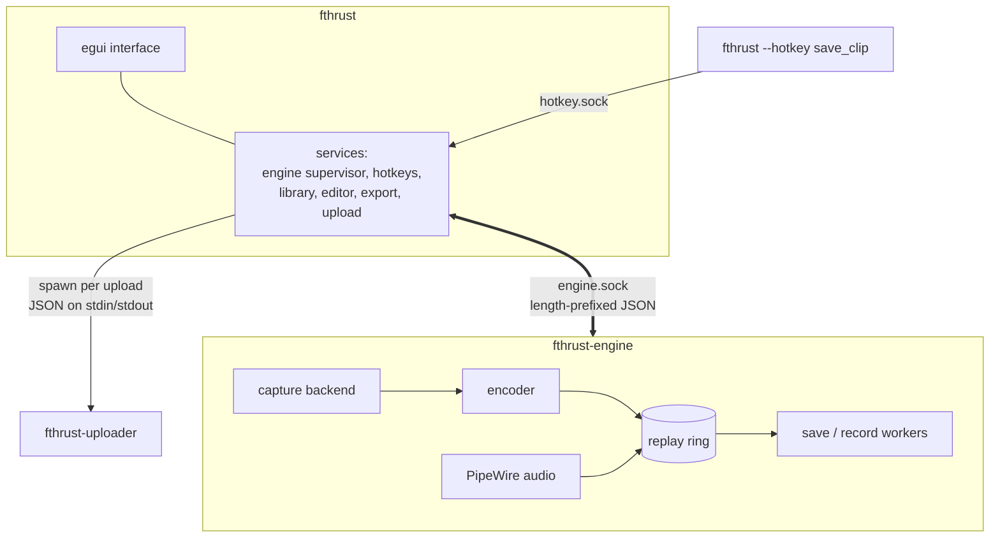
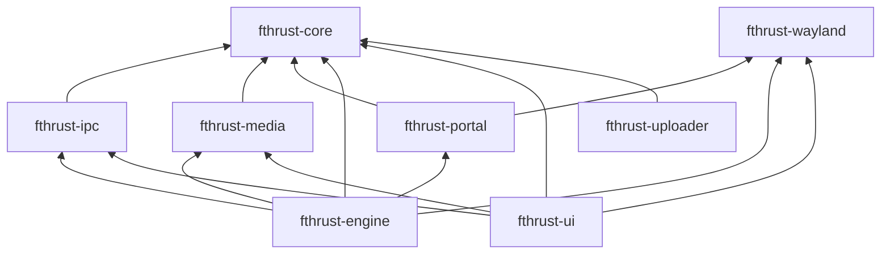

# Architecture

How FTHRust Clips is put together: three processes, eight crates, and the rules that keep them apart.

- [Three processes](#three-processes)
- [Crates](#crates)
- [The engine](#the-engine)
- [The engine protocol](#the-engine-protocol)
- [Engine supervision](#engine-supervision)
- [Hotkey delivery](#hotkey-delivery)
- [The uploader](#the-uploader)
- [Design rules](#design-rules)

## Three processes

| Process | Does | Lives |
|---|---|---|
| **`fthrust`** | The window: library, editor, settings, export queue, overlays. Owns the settings and supervises the other two. | For the whole session. One instance per user. |
| **`fthrust-engine`** | Screen and audio capture, encoding, the replay ring, saving clips and recordings. | Started and restarted by the app. Exits if the app goes away. |
| **`fthrust-uploader`** | All network and keyring code. Handles exactly one request, then exits. | Seconds to minutes, once per upload or connection test. |

Why split them? Capture has to keep running smoothly while the interface does heavy work, like decoding previews, rendering exports or laying out a big library. If the engine crashes, the app notices and restarts it without losing your window. The uploader is split out so the main app can promise it contains no network code at all.

## Crates

| Crate | Role |
|---|---|
| **`fthrust-core`** | Everything stored on disk and the logic around it: settings and their migrations, presets, hotkeys (including the Hyprland config writer), the library scan, clip metadata, clip naming, editor and export models, upload settings and validation, diagnostics and redaction, and paths. All of it stays byte-compatible with the original FTHR Clips `~/.fthr` files. No I/O beyond the filesystem. |
| **`fthrust-ipc`** | The app ↔ engine protocol: message types, framing, the socket transport, and engine config normalisation. `#![forbid(unsafe_code)]`. |
| **`fthrust-media`** | The FFmpeg layer, via `ffmpeg-next`: encoders and encoder choice, startup capability probing, the encoded-packet ring, the clip writer and transactional saves, recording, export rendering, playback and preview decoding, thumbnails, camera input. |
| **`fthrust-wayland`** | Wayland protocol clients: `ext-image-copy-capture` and `wlr-screencopy` capture, output and toplevel lists, layer-shell surfaces for overlays, shared memory buffers. |
| **`fthrust-portal`** | The ScreenCast portal session (through `ashpd`), its PipeWire video stream, and the restore token. |
| **`fthrust-engine`** | The `fthrust-engine` binary: the daemon loop, backend selection and recovery policy, the content watchdog, PipeWire audio, device listing, and the save and record workers. |
| **`fthrust-ui`** | The `fthrust` binary: the egui app on a winit + wgpu runner, every page, popup and dialog, the editor, and the services that talk to the engine, the uploader, portals and the compositor. Also the fidelity markers and the widget dump the test bench reads. |
| **`fthrust-uploader`** | The `fthrust-uploader` binary: Catbox and custom-server HTTP (`reqwest`), SFTP (`russh`), and the Secret Service keyring. |

## The engine

**Capture.** On start, the engine picks a backend: `ext-image-copy-capture` first, then `wlr-screencopy`, then the ScreenCast portal. When capture fails it retries the last working backend first, backing off 250 ms, 750 ms and 1.5 s. It never re-opens the portal on its own (unless the portal was the last one that worked), because that would put a permission dialog in front of a game. A watchdog watches for blank or frozen content and triggers recovery.

**Encoding.** Frames go to a hardware encoder chosen by `fthrust-media::encoder_policy`: NVENC, then VA-API (and AMF), then Quick Sync, or software only when the user explicitly asks for it. Which encoders actually work is decided at app startup by test-encoding one frame with each, in a child process with a 5-second timeout, and cached in `~/.fthr/encoder_capabilities.json`.

**The ring.** Encoded packets go into an in-memory ring sized for the longest configured clip plus 2 seconds. Its memory budget is about *bitrate × (buffer + 5 s) × 1.25 + 64 MiB*, clamped between 64 MiB and 16 GiB and never more than half of RAM.

**Saving.** A save copies the last N seconds of packets (starting on a keyframe) plus the matching audio window into an MP4 on a worker thread, without re-encoding the video. Audio is encoded as AAC at this point. The file is written as `.partial` and renamed when complete, so the library never shows a half-written clip. Only one save runs at a time.

**Recording** taps the same packet stream. If the writer falls more than 8 seconds behind, the recording is stopped with an error rather than eating memory.

**Audio** is one PipeWire capture stream per source (the default sink's monitor, and the chosen microphone), as 48 kHz stereo float. Streams reconnect every second if they drop.

## The engine protocol

The app and engine talk over a Unix socket at `$XDG_RUNTIME_DIR/fthrust/engine.sock` (falling back to `~/.fthr/run/`). The directory is `0700` and the socket `0600`.

Each message is a **little-endian `u32` length followed by a JSON body**, up to 16 MiB. The engine serves one client at a time.

**Commands** (app → engine)

| Command | Meaning |
|---|---|
| `Configure(EngineConfig)` | Apply capture settings: size, fps, bitrate, codec, encoder, monitor, audio devices, crop, buffer length. |
| `SaveClip`, `StartRecording`, `StopRecording` | The obvious. |
| `Pause`, `Resume` | Pause capture, for example while the game isn't focused. |
| `GetStatus` | Ask for a status snapshot. |
| `Shutdown` | Exit cleanly. |

**Events** (engine → app)

| Event | Meaning |
|---|---|
| `Hello` | First message. Carries `PROTOCOL_VERSION` (currently 1). |
| `StartupWarning`, `StartupError` | Something optional failed (`DESKTOP_AUDIO_UNAVAILABLE`), or something essential did (`WAYLAND_UNAVAILABLE`, `ENCODER_UNAVAILABLE`, `CAPTURE_DECLINED`…). |
| `Configured` | Settings applied. |
| `Status(StatusSnapshot)` | Backend, recording state, source and audio health. |
| `SaveStarted`, `SaveProgress`, `SaveResult` | A clip save's lifecycle. |
| `RecordingStarted`, `RecordingStopped`, `RecordingError` | A recording's lifecycle. |
| `Heartbeat` | Every 500 ms, so the app knows the engine is alive. |

## Engine supervision

The app's engine service (`fthrust-ui/src/services/engine.rs`) is a state machine around a driver task:

1. **Spawn** `fthrust-engine --socket <path>` from `$FTHRUST_ENGINE` or next to the app, with stdin piped. The engine treats stdin closing as "the app is gone" and exits.
2. **Connect**, retrying 60 times at 150 ms intervals, then wait up to 9 seconds for `Hello`.
3. **Configure**, and wait up to 30 seconds for healthy capture before showing **SETTINGS APPLY TIMED OUT**.
4. **Watch.** Three seconds without any event means the engine is gone. An unexpected exit shows **ENGINE STOPPED** with **RESTART ENGINE**.
5. **Restart** with a 1-second gap. A restart requested during a save waits for the save to finish.
6. **Stop** with `Shutdown`, then SIGTERM, then SIGKILL.

## Hotkey delivery

Wayland doesn't let an app see key presses aimed at other windows, so global hotkeys arrive from outside. There are three paths, all ending in the same place:

1. **The hotkey socket.** `fthrust --hotkey <action>` connects to `$XDG_RUNTIME_DIR/fthrust/hotkey.sock`, writes the action name and exits. The running app validates the name (64 characters at most, must be a known action) and acts on it.
2. **Hyprland.** `fthrust-core::hotkeys::hyprland` writes `bind = MODS, KEY, exec, "<exe>" --hotkey <action>` lines to a managed file (or a fenced Lua block) and the app runs `hyprctl reload`. The `<exe>` is `$APPIMAGE` when running from an AppImage, so binds survive the AppImage's temporary mount path changing.
3. **The GlobalShortcuts portal**, registered as `space.kalopsia.fthrust`. The portal delivers activations directly, and the app adopts whatever triggers the desktop actually bound.

Single-instance activation uses the same idea: a second launch finds `fthr.lock` held, sends `activate` to the first instance's socket, and exits.

## The uploader

The app runs `fthrust-uploader` (from `$FTHRUST_UPLOADER`, or next to the app) in its own process group, writes **one JSON request** to its stdin, and reads the **last line of stdout** as a JSON reply. The exit code is 0 only when the reply is `ok`.

| Action | Does |
|---|---|
| `upload` | Upload one clip. Replies with the link, if any. |
| `test_connection` | Check settings without uploading. |
| `sftp_save`, `sftp_forget` | Store or remove an SFTP password in the keyring. |

Every request carries the accepted Terms and Privacy versions, and the uploader refuses if they don't match its own. It reads only from the clips folder and imported folders. The app kills it after 10 minutes for an upload, 75 seconds for a connection test, or 30 seconds for keyring actions.

## Design rules

These hold across the codebase, and the checks in [Development](development.md#checks-and-scripts) enforce several of them:

- **Wayland only.** No X11 code paths.
- **No network code outside the uploader.** Checked on every CI run.
- **`~/.fthr` stays compatible.** The original FTHR Clips and FTHRust read the same files. Formats live in `fthrust-core`, with fixtures generated from the original app.
- **Never lose a clip silently.** Saves are transactional (`.partial`, then rename), failures are reported in the error bar with a code, and a clip is only auto-deleted after an upload is confirmed *with* a link.
- **No surprise dialogs mid-game.** The portal is never re-opened automatically, and automatic encoder choice never silently falls back to the CPU.
- **Pixel fidelity.** The interface matches the original Qt app, verified marker by marker (see [UI fidelity tests](development.md#ui-fidelity-tests)).
- **One version**, in the root `Cargo.toml`.
