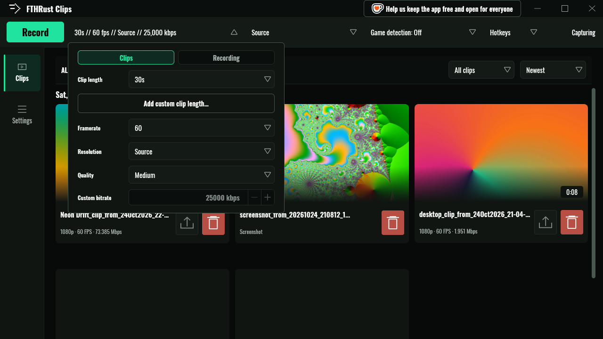
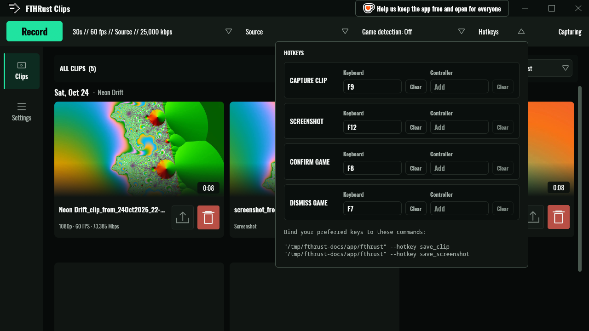
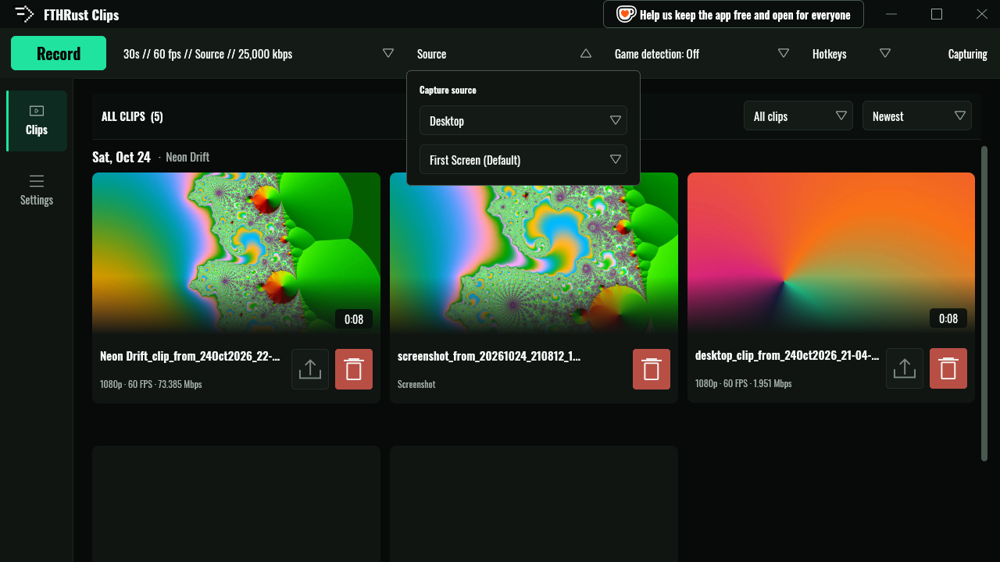
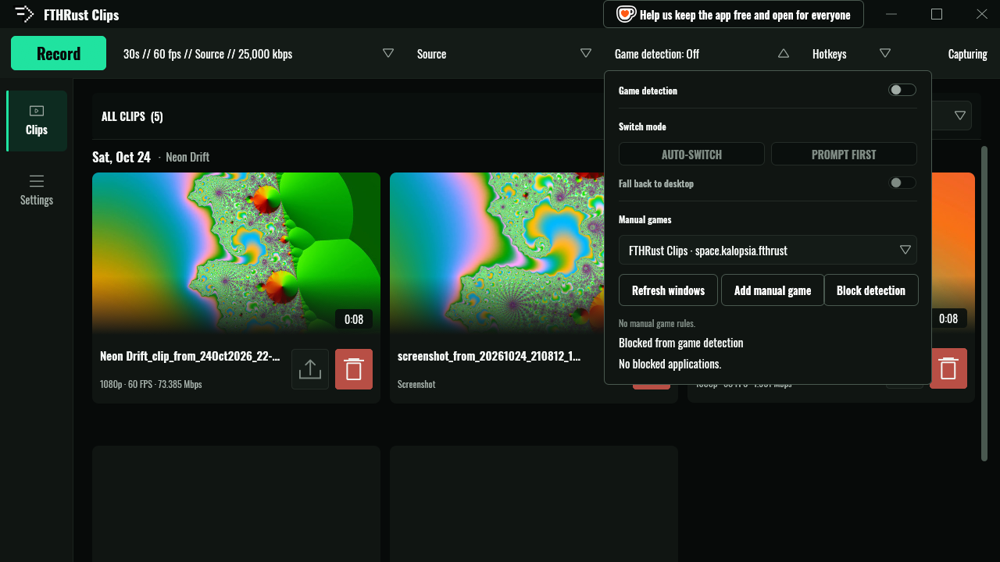
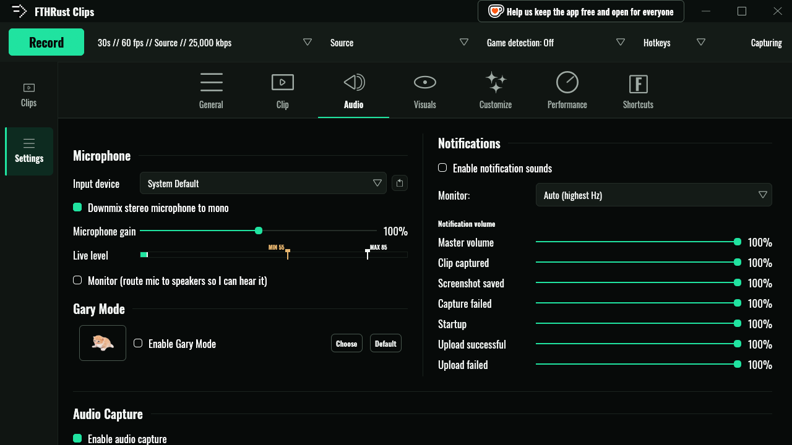

# Capturing

Everything about getting gameplay onto your disk: the replay buffer, full recordings, screenshots, hotkeys, sources, audio and quality.

- [The replay buffer](#the-replay-buffer)
- [Full recordings](#full-recordings)
- [Screenshots](#screenshots)
- [Hotkeys](#hotkeys)
- [What gets captured](#what-gets-captured)
- [Game detection](#game-detection)
- [Audio](#audio)
- [Quality and encoders](#quality-and-encoders)
- [Where files go](#where-files-go)
- [What's not there yet](#whats-not-there-yet)

## The replay buffer

While the toolbar says **Capturing**, the engine is encoding your screen and keeping the result in memory. Press **F9** (*Capture clip*) and the last N seconds are written to an MP4. Video is copied as-is rather than re-encoded, so the save takes a moment, not a minute, and capture carries on while it happens.



Click the capture summary in the toolbar (`30s // 60 fps // Source // 25,000 kbps`) to change the setup. The **Clips** tab controls the replay buffer:

| Setting | Options | Default |
|---|---|---|
| **Clip length** | 5, 10, 15, 30, 45, 60, 90, 120, 180, 240 or 300 seconds | 30 s |
| **Framerate** | 30, 60, 90, 120, 144, 165, 180, 240 | 60 |
| **Resolution** | 480p, 720p, 1080p, 1440p, Source | Source |
| **Quality** | Low, Medium, High, Custom (500 to 200,000 kbps) | Medium |

Press **Apply** to restart capture with the new settings. A restart empties the buffer, so don't change settings straight after the play you wanted.

### Extra clip lengths

**Add custom clip length…** adds another length (anything from 5 seconds to 15 minutes) with its own hotkey. Keep F9 for "last 30 seconds" and put "last 3 minutes" on F10, for example. Each custom length shows up as **CLIP *n*** in the Hotkeys popup.

The buffer always holds the longest length you've set up, plus two seconds of headroom.

### How much memory it uses

The buffer is encoded video, so its size is roughly *bitrate × length*. At the defaults (25 Mbps for 30 s) that's about 100 MB. Long lengths at high bitrates add up fast: 5 minutes at 50 Mbps is close to 2 GB. The rest of the app is small next to that: at 1080p180 and 50 Mbps with 45-second clips, the capture engine measured about 430 MB in total (most of it the buffer) and the window about 185 MB. FTHRust never lets the buffer go past half your RAM, and the popup reminds you that *longer clips can use a lot of memory, especially at high quality*.

**Replay buffer on disk.** In the capture settings popup, *Replay buffer* can be set to **Disk**. The engine then writes the buffer's video into `~/.cache/fthrust/replay/<pid>/` (or `$XDG_CACHE_HOME`), readable only by you, and keeps only a small index in RAM. At 50 Mbps that's about 22 GB of writes per hour of capture, which a modern SSD shrugs off. The folder is deleted when the engine exits, and any left behind by a crash are removed at the next start. If the folder can't be written, the buffer quietly stays in memory. The default is **Memory**.

### When a save is refused

You'll get a capture card instead of a clip if:

- capture is paused, restarting or recovering, or the buffer is still refilling after a restart,
- another save is still being written ("A clip save is already in progress"),
- or the disk is too full or the path too long. [Troubleshooting](troubleshooting.md#error-codes) lists each error.

## Full recordings

**Record** in the toolbar (or the *Start recording* / *Stop recording* hotkeys, unbound by default) captures until you stop it. Recordings have their own quality settings on the **Recording** tab of the capture popup, so you can keep a light replay buffer and record at full quality, or the other way round.

- Recordings are saved as `FTHR_recording_YYYY-MM-DD_HH-MM-SS.mp4` in `~/Videos/FTHR Clips/Recordings`. You can change the folder in **Settings → Clip → Folders**.
- A recording needs 512 MB free to start, and stops itself cleanly if free space drops below 256 MB.
- If the recording quality differs from the replay quality, capture restarts once at the recording settings, and again when you stop. The replay buffer starts empty after each restart.

## Screenshots

**F12** (*Screenshot*) takes a PNG through your desktop's screenshot portal and saves it to `~/Videos/FTHR Clips/Screenshots/`. Screenshots show up in the library next to your clips; use the **Screenshots** filter to see only them.

## Hotkeys



| Action | Default |
|---|---|
| Capture clip | F9 |
| Screenshot | F12 |
| Confirm game (game detection prompt) | F8 |
| Dismiss game | F7 |
| Start / stop recording | unbound |
| Each custom clip length | unbound |

Change them in the **Hotkeys** popup in the toolbar. Hotkeys are global: they work while your game has focus.

Wayland doesn't let apps read the keyboard while another window has focus, so FTHRust asks your desktop to deliver the keys for it. How depends on your desktop:

### Hyprland: automatic

FTHRust writes your bindings to `~/.config/hypr/fthr-hotkeys.conf`, adds a single `source = ~/.config/hypr/fthr-hotkeys.conf` line to `hyprland.conf` the first time, and runs `hyprctl reload`. Change a key in the popup and the file is rewritten. It never creates `hyprland.conf` for you, and never adds the `source` line twice.

On Lua configs (a `custom/keybinds.lua` or `hyprland.lua` exists), it maintains a fenced block in `custom/keybinds.lua` instead, between `-- FTHR Clips hotkeys begin (managed)` and `-- FTHR Clips hotkeys end (managed)`. Edit outside those markers as you please. If the block looks broken, FTHRust leaves the file alone rather than guess.

### KDE, GNOME and others: the shortcuts portal

On desktops with the GlobalShortcuts portal, FTHRust registers its actions and your desktop shows its own dialog to confirm the keys. **Your desktop has the final say.** If it keeps a different key than the one you asked for, the popup warns you and shows what's actually bound, and **EDIT IN DESKTOP SETTINGS** takes you to the right place to change it.

### Anything else: bind a command

Every action can be triggered from the command line, so any desktop that can bind a key to a command can drive FTHRust:

```sh
/path/to/FTHRust-x86_64.AppImage --hotkey save_clip
```

The action names are `save_clip`, `save_screenshot`, `start_recording`, `stop_recording`, `confirm_game_detection`, `dismiss_game_detection` and `save_custom_clip_<seconds>` (for example `save_custom_clip_180`). The Hotkeys popup lists the exact command lines for your install, and **COPY LINE** copies one.

`--hotkey` hands the action to the running app over a private socket and exits straight away. If the app isn't running, it prints "FTHR Clips is not running".

## What gets captured



**Source** in the toolbar picks a mode and a monitor:

- **Desktop** captures the whole monitor. Clips go to the `Desktop` folder.
- **Window / Game** picks one of your open windows. Clips are filed under that game's name (`Neon Drift/Neon Drift_clip_from_…mp4`), and game detection uses the same mode.

> **Heads-up:** Window / Game mode still records the **whole monitor** the window is on. Capturing a single window by itself isn't implemented yet. Today the mode decides where clips are filed, how they're named, and which window the focus pause watches.

The monitor list defaults to **First Screen (Default)**. Pick a specific output if you game on a second monitor.

Behind the scenes the engine tries three ways of capturing, in order: `ext-image-copy-capture`, `wlr-screencopy`, then the desktop's ScreenCast portal. The first two need no permission dialog. The portal asks once, remembers your answer, and is never re-opened on its own while recovering from an error, so a dialog never pops up mid-game. The cursor is included in all three.

If capture stalls (a frozen or blank feed), the engine notices, recovers, and shows **RECOVERING CAPTURE** while it does.

## Game detection



Game detection watches your windows and switches capture into Window / Game mode when a game shows up. It's **off by default**; turn it on in the **Game detection** popup or with **Shift+G**.

A window counts as a game if it's **fullscreen**, or if it matches one of your **Manual games** (by title or app ID), and it isn't on the **Blocked from game detection** list.

| Switch mode | What happens |
|---|---|
| **AUTO-SWITCH** | Capture switches to the game straight away. |
| **PROMPT FIRST** | A card asks "*Game* detected — [F8] Record [F7] Dismiss". If you don't answer within 15 seconds it's dismissed, and that window won't ask again. |

**Fall back to desktop** switches back to Desktop mode when the game closes. **Refresh windows** re-reads the window list, **Add manual game** turns the selected window into a rule, and **Block detection** stops a window from ever counting.

Game detection needs your compositor to share its window list (`wlr-foreign-toplevel-management`). Hyprland, Sway and other wlroots desktops do. KDE and GNOME don't, so the button reads **Game detection unavailable** there.

## Audio

Audio settings live in **Settings → Audio**.



- **Desktop audio** is on by default (*Enable audio capture*). FTHRust records what your speakers or headphones play by tapping your default output's monitor. Pick a specific device under **Playback device to capture**; if it's missing when capture starts, the default output is used instead.
- **Microphone** is off until you choose an **Input device**. **Live level** shows a meter so you can check it's picking you up.
- Each clip gets up to two AAC tracks: **Default Mix** (desktop) and **Microphone**. Most players and editors let you mute or mix them separately.

If PipeWire can't be reached, capture carries on silently and the bar at the bottom shows **DESKTOP AUDIO UNAVAILABLE** with a shortcut to the audio settings.

## Quality and encoders

### Bitrate

The Low, Medium and High quality levels map to bitrates by resolution (in kbps):

| Resolution | Low | Medium | High |
|---|---|---|---|
| 480p | 2,500 | 5,000 | 10,000 |
| 720p | 5,000 | 12,000 | 20,000 |
| 1080p | 10,000 | 25,000 | 50,000 |
| 1440p | 15,000 | 35,000 | 60,000 |
| Source | 10,000 | 25,000 | 50,000 |

**Custom** takes any value from 500 to 200,000 kbps. For fast games at 1440p and above, Custom at 60,000 or more is worth trying.

### Encoders

**Settings → Clip → Video Encoding** chooses the encoder and codec.

On first start, FTHRust tests every encoder your system might have with a real one-frame encode, and lists only the ones that actually worked. Results are cached; press **Redetect** after a driver update.

| Encoder | For |
|---|---|
| **NVIDIA NVENC** | NVIDIA GPUs. Supports the speed/quality preset (P1 Fastest … P4 Balanced … P7 Best Quality). |
| **VA-API (AMD / Intel)** | AMD and Intel GPUs through Mesa or Intel's media driver. |
| **Intel Quick Sync** | Intel GPUs. |
| **Software** | No GPU encoder at all. Uses OpenH264, Kvazaar (HEVC) or SVT-AV1 on your CPU. |

**Automatic (recommended)** tries NVENC, then VA-API, then Quick Sync, and **never falls back to software on its own**. If none works you get a clear error rather than a game that suddenly stutters. Choose **Software** yourself if that's what you want.

**Codec** is H.264, HEVC or AV1. Automatic prefers H.264, which every chat app and browser plays, and only moves on to HEVC or AV1 if your encoder can't do H.264. HEVC and AV1 give smaller files at the same quality if your encoder supports them.

On systems with several GPUs, VA-API uses the first render node that works. Set `FTHR_VAAPI_DEVICE=/dev/dri/renderD129` to choose one.

## Where files go

Everything lives under your clips folder, `~/Videos/FTHR Clips` by default (change it in **Settings → Clip → Folders**):

```
~/Videos/FTHR Clips/
├── Desktop/        desktop_clip_from_24Oct2026_21-04-55.mp4
├── Neon Drift/     Neon Drift_clip_from_24Oct2026_22-31-40.mp4   (one folder per game)
├── Recordings/     FTHR_recording_2026-10-24_21-30-00.mp4
├── Screenshots/    screenshot_from_20261024_210812_123456.png
├── Exported/       edits exported from the editor
└── Shared/         size-targeted files made by Share
```

Game names are cleaned up for use as folder names: characters like `/ : * ? "` are removed and the name is cut to 32 characters. If a file name is already taken, `_2`, `_3` and so on are added. Files still being written end in `.partial` and are never shown in the library.

## What's not there yet

FTHRust is an alpha. These pieces are visible in the interface but not fully wired up:

- **Single-window capture.** Window / Game mode records the whole monitor (see [above](#what-gets-captured)).
- **Microphone gain, mono downmix and monitoring.** The controls are saved and the gain moves the live meter, but recorded audio isn't changed by them yet.
- **Separate audio tracks setting.** Clips always get the same two tracks, whichever way *Keep system and microphone audio as separate tracks* is set.
- **Per-app audio.** Desktop audio is one mix; you can't capture only the game.
- **Controller hotkeys.** The Hotkeys popup has a Controller column, but controller buttons don't trigger anything yet.
- **Focus pause.** Pausing capture while your game is in the background works, but it has no switch in the interface yet. Set `"anticheat_detection_enabled": true` in `~/.fthr/settings.json` to turn it on.
