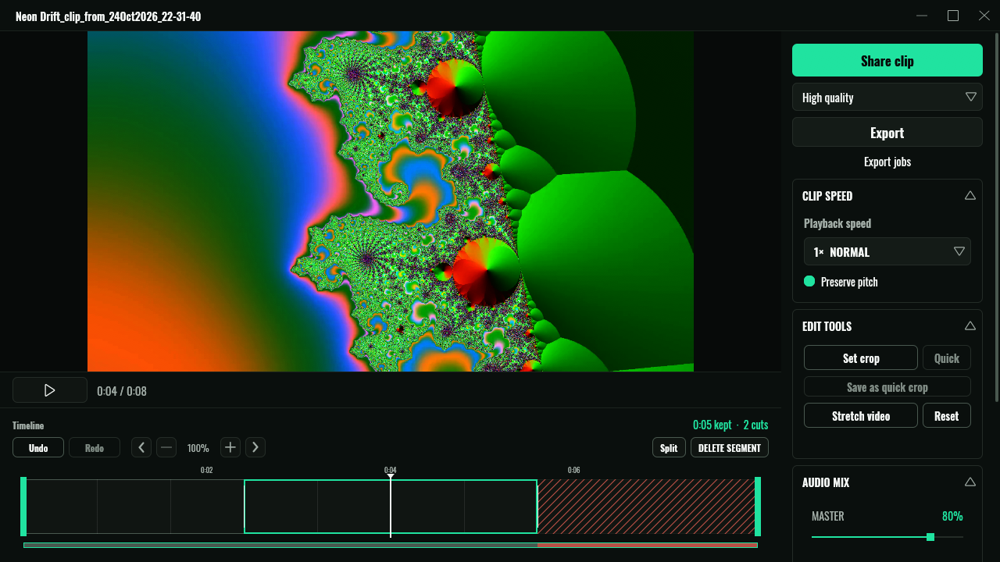
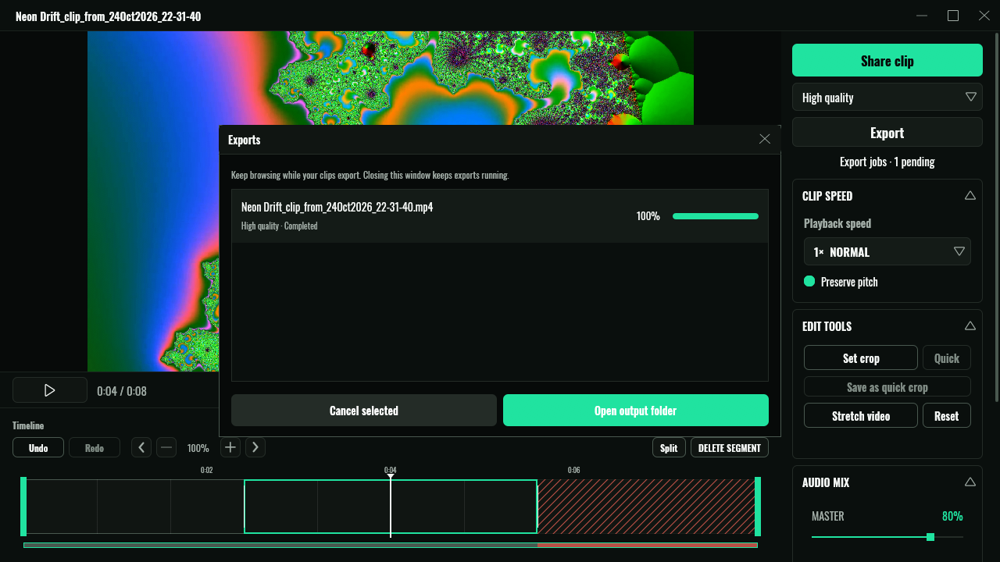

# Library and editor

Your clips, how to cut them down, and how to get them out of the app in a shape other people can watch.

- [The library](#the-library)
- [The editor](#the-editor)
- [Exporting](#exporting)
- [Sharing](#sharing)
- [The export queue](#the-export-queue)
- [Keyboard shortcuts](#keyboard-shortcuts)

## The library

The **Clips** page shows everything in your clips folder, grouped by day, newest first. Each card shows a thumbnail with the clip's length, its name, and its resolution, frame rate and bitrate (`1080p · 60 FPS · 25 Mbps`).

- **Click a clip** to open it in the editor.
- **Hover a card and press F2** to rename it.
- **Right-click** for *Open in editor*, *Show in file manager*, *Copy path*, *Upload*, *Open uploaded link* and *Delete clip*.
- The **share button** on a card uploads the clip, or copies its link if it's already uploaded. It needs the [uploader](uploads.md) to be enabled.
- The **bin button** deletes the clip after asking. Deleting is permanent; there's no trash.

The filter in the top right switches between **All clips**, **Clips only**, **Screenshots** and **Imported clips**. Sort by **Newest** or **Oldest**.

Badges on a card tell you more: **Uploaded**, **Imported** (from a folder you added) and **Finalizing** (still being written).

### Importing folders you already have

Got years of clips somewhere else? **Settings → Clip → Import Clips → Add folder** adds a folder to the library without moving or copying anything. **Scan for clips** looks for new files. Imported clips appear under the **Imported clips** filter. MP4, MKV and AVI videos and PNG and JPEG images are picked up. Symlinks aren't followed.

The library has no database of its own: it reads your folders every time, so files you add, rename or delete in a file manager show up straight away. Tags, descriptions and editor drafts are kept in `~/.fthr/clip_metadata.sqlite3`.

## The editor

The editor never touches your original file. Every change (cuts, crops, speed, colour, audio levels) is saved as a **draft** a moment after you make it, and comes back when you reopen the clip. Nothing new is written to disk until you **Export** or **Share**.

### Cutting

The timeline under the player shows a filmstrip of the clip.

1. Click the timeline to move the playhead, or press **Space** to play.
2. Press **Split** (or **Ctrl+C**) to cut the clip at the playhead.
3. Click a segment and press **DELETE SEGMENT** (**Ctrl+D**). Deleted segments show as hatched.
4. Changed your mind? Select it again and press **RESTORE SEGMENT** (**Ctrl+W**).

Playback skips deleted segments, so what you see is what you'll export. The header tells you how much you're keeping (`0:05 kept · 2 cuts`). **Undo** and **Redo** (**Ctrl+Z**, **Ctrl+Y**) cover every edit.

Scroll on the timeline to zoom in around the cursor, and hold **Shift** while scrolling to pan. Right-click for *Split here*, *Delete segment* and *Hide deleted segments*.

### The sidebar

| Panel | What it does |
|---|---|
| **CLIP SPEED** | 0.25× to 2× playback, with *Preserve pitch*. |
| **EDIT TOOLS** | **Set crop** draws a crop box (with 16:9 and 9:16 guides for vertical video). **Quick** applies your saved quick crop, and **Save as quick crop** stores the current one for next time. **Stretch video** resizes the picture. **Reset** clears it all. |
| **AUDIO MIX** | A master volume plus one row per audio track, each with **MUTE**. |
| **COLOR & EFFECTS** | Exposure, Contrast, Saturation, Temperature, Sharpness and Vignette, previewed live. **Reset look** puts them back. |
| **CLIP DETAILS** | A title, a tag (*Gaming*, *Highlight*…) and a description, kept with the clip. |
| **FILE DETAILS** | Created date, resolution, bitrates, duration, size and location. |

### Juggling clips

You can keep up to three clips open. The minimise button in the editor header parks the clip in the left rail as **Editor 1**, **Editor 2** and so on. Click one to come back to it, or right-click to close it. **Escape** closes the editor and **F11** goes fullscreen.

On a slow PC, **Settings → Performance** can turn the full editor off, so clips open in a simple player instead.

## Exporting

**Export** (or **Ctrl+E**) renders your edit into a new file in `~/Videos/FTHR Clips/Exported/`. Choose the quality in the dropdown above it:

| Quality | Use it for |
|---|---|
| **Very fast** | Quick drafts. |
| **High quality** | The default. A good-looking H.264 MP4 that plays anywhere. |
| **Lossless · MKV** | Archiving or further editing. Big files, and chat apps may not preview them. |

## Sharing

**Share clip** makes a file that's ready to post. Pick a preset under **Share as**:

- **Discord · 10 MB** squeezes the clip under Discord's free upload limit, at 60 fps.
- **Your own presets**, from **Settings → General → Export Presets**: give one a name, a target size (1 to 10,000 MB), and optional resolution, frame rate and audio limits.

Shared files go to `~/Videos/FTHR Clips/Shared/`. When the file is ready, **Copy path** and **Open folder** get it to wherever it's going. Size presets need **Very fast** or **High quality**, because lossless output can't be squeezed to a size.

If you've set up [uploading](uploads.md) to Catbox, clips over Catbox's 200 MB limit can be compressed for you automatically before they're sent.

## The export queue

Exports and shares run in the background, so you can keep browsing, editing or playing. **Export jobs** in the editor sidebar opens the queue: progress for each job, **Cancel selected**, and **Open output folder**. Closing the window doesn't stop anything.

By default one job runs at a time. **Settings → Performance → Allow simultaneous exports** allows two to four, at the cost of more CPU, GPU and disk load while you're gaming.

## Keyboard shortcuts

All of these can be changed in **Settings → Shortcuts**, except F11.

**In the editor**

| Action | Key |
|---|---|
| Play / pause | Space |
| Split at playhead | Ctrl+C |
| Delete segment | Ctrl+D |
| Restore segment | Ctrl+W |
| Quick crop | Ctrl+Q |
| Export | Ctrl+E |
| Undo / redo | Ctrl+Z / Ctrl+Y (or Ctrl+Shift+Z) |
| Next / previous clip | Tab+Right / Tab+Left |
| Minimise editor | Shift+Escape |
| Close editor | Escape |
| Fullscreen | F11 |

**Everywhere in the app**

| Action | Key |
|---|---|
| Switch Clips / Settings | Tab+S |
| Next / previous sidebar item | Shift+Down / Shift+Up |
| Next / previous settings tab | Shift+Right / Shift+Left |
| Scroll clips | Up / Down |
| Toggle game detection | Shift+G |
| Restart capture engine | Alt+Shift+R |

"Tab+S" means hold Tab and press S. Shortcuts never fire while you're typing in a text field.
