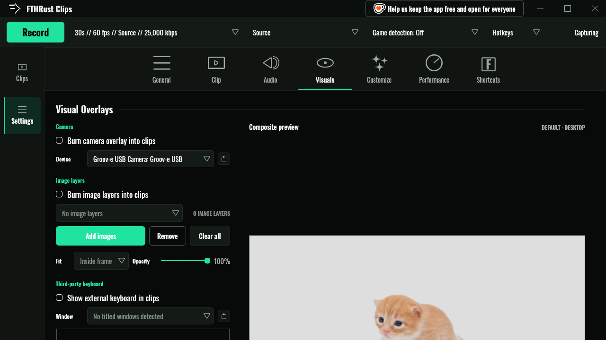

# Overlays

Things FTHRust can draw into your clips or onto your screen: a webcam, images, a keyboard overlay, Gary, and the capture card.

- [Burned-in overlays](#burned-in-overlays)
  - [Webcam](#webcam)
  - [Image layers](#image-layers)
  - [Keyboard overlay](#keyboard-overlay)
- [Gary Mode](#gary-mode)
- [The capture card](#the-capture-card)

## Burned-in overlays

**Settings → Visuals** holds everything that gets drawn **into** saved clips. On the right is the **Composite preview**, a mock frame where you arrange it all: drag a box to move it, and drag its edges to resize it. Boxes are kept on screen and at least 5% of the frame in size.

Overlays are burned in when a clip is saved, so they're part of the file wherever it goes. Your live capture and the replay buffer stay clean.

**Preview background → Choose image** puts a screenshot of your game behind the preview, so you can place things around its HUD. **Use default** brings back the stock picture.

### Webcam

1. Tick **Burn camera overlay into clips**.
2. Choose your camera under **Device**. The refresh button rescans if you plugged it in after starting the app.
3. Drag the **CAMERA** box in the preview to where you want it.

If the camera disappears or fails mid-session, the bar at the bottom shows **CAMERA UNAVAILABLE** or **CAMERA OVERLAY FAILED**, and clips keep saving without it.

### Image layers

Logos, borders, a face-cam frame: add as many images as you like.

1. Tick **Burn image layers into clips**.
2. **Add images** picks one or more files. Each becomes a layer, shown as **IMAGE 1**, **IMAGE 2**… in the preview.
3. Select a layer to set its **Fit**: **Inside frame** keeps its shape, **Fill frame** covers the whole box. **Opacity** fades it.
4. **Remove** deletes the selected layer and **Clear all** deletes them all.

### Keyboard overlay

Show your key presses in clips using a NohBoard-style keyboard window.

1. Run your keyboard overlay app so its window is open.
2. Tick **Show external keyboard in clips** and pick its **Window**.
3. Click **Pick from preview**, then click the overlay's solid background colour, so FTHRust knows what to make transparent. **Intensity** sets how strictly that colour is removed.

## Gary Mode

Gary is a picture that pops up on your screen and grows when you're loud. Shout during a clutch and Gary gets *big*.

Turn him on in **Settings → Audio → Gary Mode** (**Enable Gary Mode**). Gary listens to the microphone chosen above it, so pick one first.

- The meter under **Live level** shows your mic. Drag **MIN** to where Gary should start appearing and **MAX** to where he's at full size.
- **Choose** swaps Gary for any picture you like, and **Default** brings him back.
- Gary is click-through: he never steals your mouse or keyboard.
- Roughly one time in ten, Gary is a cat.

Gary is drawn on your screen rather than burned into files, but since he's on the monitor you're capturing, he ends up in your clips too. That's rather the point. He needs a compositor with `wlr-layer-shell`, which Hyprland, Sway and KDE have and GNOME doesn't.

## The capture card

The capture card is the small notification that slides in when you save a clip, take a screenshot, finish an upload, or something goes wrong. It shows what happened and the clip's stats, and fades out on its own.

Choose which cards you see in **Settings → General → Notifications → Capture card**:

- **All notifications**
- **Clips, recordings and screenshots only**
- **Game detection / window switching only**
- **Off**

Pick which monitor it appears on under **Settings → Audio → Notifications → Monitor** (**Auto (highest Hz)** picks your gaming monitor). Restyle it in **Settings → Customize → Capture Card**. On desktops without `wlr-layer-shell`, cards arrive as ordinary desktop notifications.

**Settings → Clip → Watermark** can also burn an animated capture card into the files made by Export and Share.

Each card can play a sound. See [Settings → Audio](settings.md#audio).
