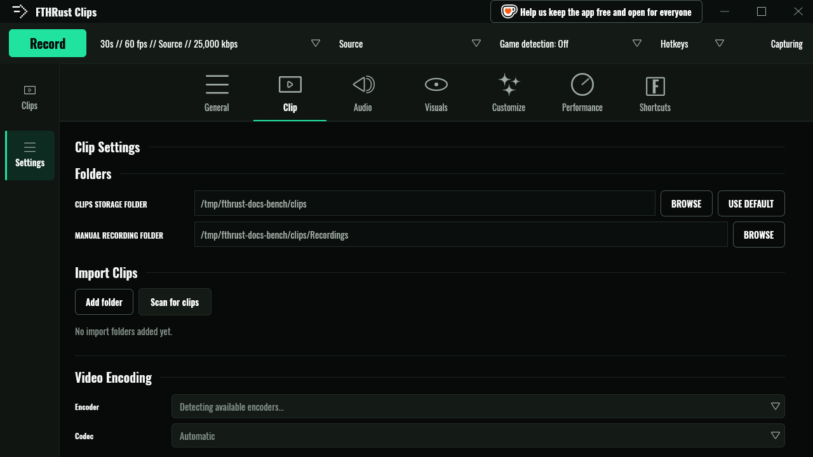
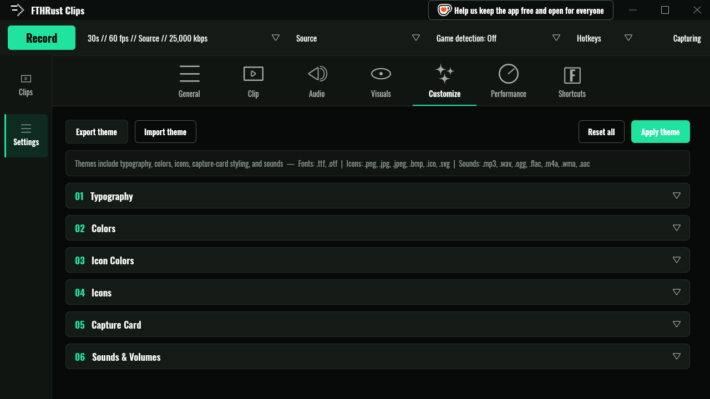
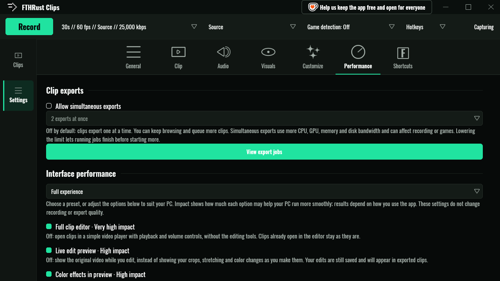
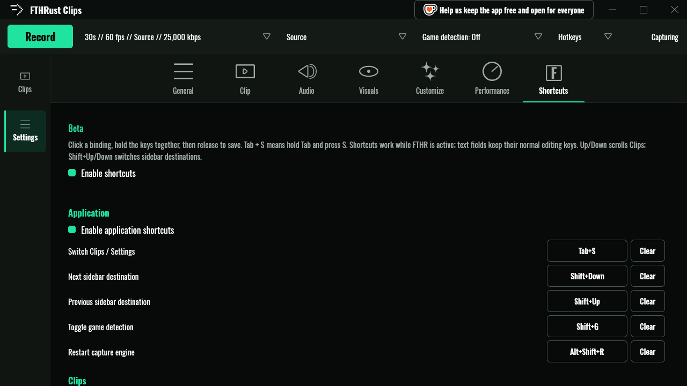

# Settings

A tour of the seven settings tabs, followed by the files FTHRust keeps on disk and the environment variables it reads.

Open settings with the gear in the left rail, or **Tab+S**. **Shift+Left** and **Shift+Right** move between tabs.

- [General](#general) · [Clip](#clip) · [Audio](#audio) · [Visuals](#visuals) · [Customize](#customize) · [Performance](#performance) · [Shortcuts](#shortcuts)
- [Files on disk](#files-on-disk)
- [Environment variables](#environment-variables)
- [Command line](#command-line)

## General

| Section | What's there |
|---|---|
| **System** | *Show Ko-fi donation widget* toggles the button in the title bar. |
| **Notifications** | *Show capture error messages*, and which **Capture card** notifications to show (see [Overlays](overlays.md#the-capture-card)). |
| **Upload** | Everything in [Uploading](uploads.md). |
| **Export Presets** | Your Share presets: **New**, **Edit** and **Delete**. Each has a name, a target size, and optional resolution, frame rate and audio bitrate limits. |
| **Troubleshooting** | **Export diagnostic report** (see [Troubleshooting](troubleshooting.md#diagnostic-reports)). |
| **Settings Presets** | Save your capture setup (clip length, frame rate, resolution, quality, encoder, codec, preset and audio on/off) under a name, and **Load** it back later. Handy for switching between a "streaming" and a "competitive" profile. |
| **App Credits** | Who made what. |

## Clip

| Section | What's there |
|---|---|
| **Folders** | **CLIPS STORAGE FOLDER** (default `~/Videos/FTHR Clips`) and **MANUAL RECORDING FOLDER** (default `Recordings` inside it), each with **BROWSE** and **USE DEFAULT**. |
| **Import Clips** | **Add folder** and **Scan for clips** (see [Library](library-and-editor.md#importing-folders-you-already-have)). |
| **Video Encoding** | **Encoder**, **Codec** and the NVIDIA preset, plus the **Active encoder** readout, **Apply** and **Redetect** (see [Quality and encoders](capturing.md#quality-and-encoders)). |
| **Watermark** | Burns an animated capture card into exports and shares. |
| **Clip Editor** | *Seek bar preview*, *Hide deleted segments in the editor seek bar*, and *Show clip length excluding deleted segments in the grid*. |

Clip length, frame rate, resolution and quality live in the capture popup on the toolbar rather than here. See [Capturing](capturing.md#the-replay-buffer).

## Audio

| Section | What's there |
|---|---|
| **Audio Capture** | *Enable audio capture*, **Playback device to capture** (with refresh), and *Keep system and microphone audio as separate tracks*. |
| **Microphone** | **Input device**, **Microphone gain**, *Downmix stereo microphone to mono*, a **Live level** meter, and *Monitor (route mic to speakers so I can hear it)*. Gain, downmix and monitor [don't affect recordings yet](capturing.md#whats-not-there-yet). |
| **Gary Mode** | See [Overlays](overlays.md#gary-mode). |
| **Notifications** | *Enable notification sounds*, which **Monitor** shows capture cards, and volume sliders for the master level and each sound: *Clip captured*, *Screenshot saved*, *Capture failed*, *Startup*, *Upload successful* and *Upload failed*. |

## Visuals

The webcam, image layers, keyboard overlay and composite preview, all covered in [Overlays](overlays.md#burned-in-overlays).

## Customize

Theme the whole app. Six sections, each with its own reset:

1. **Typography**: the heading and interface fonts (Oswald by default). **Import font** adds your own `.ttf` or `.otf`.
2. **Colors**: every surface, text and accent colour.
3. **Icon Colors**: tints for the interface icons.
4. **Icons**: replace any icon with your own image (PNG, JPEG, BMP, ICO or SVG).
5. **Capture Card**: background, left accent, text, divider, stats label and progress bar colours.
6. **Sounds & Volumes**: replace any notification sound (MP3, WAV, OGG, FLAC, M4A).

A live mock window shows your changes before you commit to them. **Apply theme** saves them. **Export theme** saves the theme as a file you can share, and **Import theme** loads one. **Reset all** goes back to stock.

## Performance

**Interface performance** has presets (**Full experience**, **Balanced**, **Low power**, **Minimal / viewer only**) for PCs that struggle to run a game and FTHRust side by side. Each option is labelled with how much it helps:

| Option | Off means |
|---|---|
| **Full clip editor** | Clips open in a simple player instead of the editor. |
| **Live edit preview** | The preview shows the original video, not your crops and stretches. Exports are unaffected. |
| **Color effects in preview** | Colour grading is applied on export only. |
| **Seek bar preview** | No thumbnail when hovering the timeline. |
| **Library thumbnails** | Cards show no picture. |
| **Animated settings previews** | Still previews in settings. |
| **Reduce interface animations** | (On, not off) Fewer slides and fades. |
| **Pause interface in background** | (On by default) The window stops redrawing while it's hidden. |

None of these change recording or export quality.

**Clip exports** holds *Allow simultaneous exports* and **View export jobs** (see [the export queue](library-and-editor.md#the-export-queue)).

## Shortcuts

Every in-app shortcut, grouped by where it works. Click a binding, hold the keys, and let go to save it. **Clear** unbinds one, and **Restore default shortcuts** puts them all back. You can turn whole groups off, or all of them with *Enable shortcuts*.

These are shortcuts **inside** the app. The global capture keys (F9, F12…) live in the **Hotkeys** popup on the toolbar; see [Hotkeys](capturing.md#hotkeys). The defaults are listed in [Keyboard shortcuts](library-and-editor.md#keyboard-shortcuts).

## Files on disk

Everything FTHRust remembers lives in `~/.fthr`. It's the same folder, and the same file formats, as the original FTHR Clips.

| Path | What |
|---|---|
| `settings.json` | All settings. A corrupt file is set aside and replaced with defaults rather than crashing the app. |
| `hotkeys.json` | Global hotkey bindings. |
| `presets.json`, `export_presets.json` | Settings presets and Share presets. |
| `clip_metadata.sqlite3` | Clip titles, tags, descriptions and editor drafts. |
| `encoder_capabilities.json` | Which encoders passed the startup test. Delete it, or press **Redetect**, to test again. |
| `portal_screencast_token` | Lets the ScreenCast portal skip its dialog next time. |
| `theme/` | Your custom theme, fonts, icons and sounds. |
| `thumbnails/`, `playback/` | Caches. Safe to delete. |
| `uploader/` | Upload settings, history and trusted SFTP host keys (see [Uploading](uploads.md#whats-stored-where)). |
| `logs/engine.log` | The capture engine's log. |
| `diagnostics/` | Diagnostic sessions and exported reports. |
| `fthr.lock` | Keeps a second copy of the app from starting. |

Outside `~/.fthr`:

| Path | What |
|---|---|
| `~/Videos/FTHR Clips/` | Your clips, unless you've moved them. |
| `~/.config/hypr/fthr-hotkeys.conf` | Hotkey binds on Hyprland. |
| `$XDG_RUNTIME_DIR/fthrust/` | Private sockets between the app, the engine and the `--hotkey` command. Only your user can open them. |

## Environment variables

You shouldn't need any of these, but they help when something's odd.

| Variable | Effect |
|---|---|
| `FTHR_CAPTURE_BACKEND` | Forces a capture method: `ext`, `wlr` or `portal`. |
| `FTHR_VAAPI_DEVICE` | Picks the VA-API render node, for example `/dev/dri/renderD129`. |
| `RUST_LOG` | Log detail for the app, for example `RUST_LOG=debug`. |
| `FTHRUST_LOG` | Log detail for the engine. |
| `FTHRUST_ENGINE`, `FTHRUST_UPLOADER` | Use a different engine or uploader binary. Normally they're found next to the app. |

## Command line

| Command | Does |
|---|---|
| `fthrust` | Starts the app, or brings the running one to the front. |
| `fthrust --hotkey <action>` | Triggers a hotkey action in the running app (see [Hotkeys](capturing.md#anything-else-bind-a-command)). |
| `fthrust --version` | Prints the version. |

With the AppImage, use the AppImage's path in place of `fthrust`.
