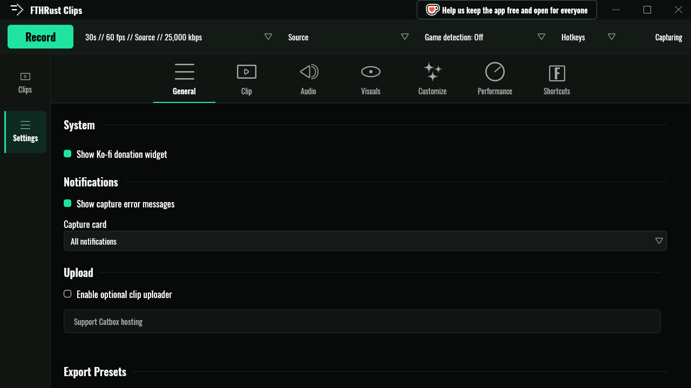

# Uploading

FTHRust can send clips to a host and hand you back a link. It's entirely optional and off by default. Until you turn it on, nothing in the app talks to the internet.

- [How it's kept separate](#how-its-kept-separate)
- [Turning it on](#turning-it-on)
- [Providers](#providers)
  - [Catbox](#catbox)
  - [Your server](#your-server)
  - [SFTP](#sftp)
- [When uploads happen](#when-uploads-happen)
- [Getting the link](#getting-the-link)
- [What's stored where](#whats-stored-where)
- [When an upload fails](#when-an-upload-fails)
- [The Your server protocol](#the-your-server-protocol)

## How it's kept separate

All upload code (HTTP, SFTP and the keyring) lives in its own program, `fthrust-uploader`. The app runs it once per upload, sends it a single request, and reads back a single answer. The main app and the capture engine never include any of that code, and CI fails the build if they ever start to. If you never enable uploads, that program never runs.

## Turning it on



1. Open **Settings → General → Upload** and tick **Enable optional clip uploader**.
2. Choose a **Provider**, fill in its fields, and press **Test connection**. Catbox asks you to accept its own policies first.
3. Press **Save upload settings**.

The **Uploader terms & privacy** link at the right of the checkbox opens the upload extension's Terms of Service and Privacy Policy. They apply while uploads are on; there is nothing to accept.

Upload settings carried over from FTHR Clips take effect at first launch, including interval uploads and auto-delete. Check the Upload section after upgrading.

## Providers

### Catbox

[Catbox](https://catbox.moe) is free, needs no account, and gives you a public `https://files.catbox.moe/…` link.

- The first time you choose it, FTHRust shows what Catbox stores (the file, its name and size, the upload time and your IP address) and asks you to accept Catbox's own terms.
- **User hash** is optional. Paste your Catbox account's userhash to have uploads show up in your account.
- Files are limited to **200 MB**. For bigger clips, FTHRust offers to compress a copy first; your original is never changed. Tick **Automatically compress oversized clips before upload** to skip the question.
- Anyone with the link can watch the clip, and it stays up until it's deleted.

Catbox is run by volunteers. **Support Catbox hosting** links to their donation page.

### Your server

Point FTHRust at your own HTTPS endpoint. It's made to pair with [FTHR Clips Server](https://github.com/kalopsia-space/fthr-clips-server), a self-hosted clip site with share pages that embed in Discord, but anything that speaks the [protocol below](#the-your-server-protocol) works.

| Field | Value |
|---|---|
| **Server URL** | The full upload URL, for example `https://clips.example.com/upload`. FTHRust posts to it exactly as written, so include the path. |
| **Auth header** | Sent as the `Authorization` header, word for word. For FTHR Clips Server: `Bearer <your upload token>`. |

**Test connection** checks the URL and token without uploading anything, and explains what's wrong if it fails: a missing path, a wrong token, nothing at that address.

There's no size limit on FTHRust's side. Your server may set one, and if it does, you'll be told the clip is too large for it.

### SFTP

Upload to any server you can reach over SFTP, such as a seedbox, a NAS or a web host.

| Field | Notes |
|---|---|
| **Host**, **Port**, **Username** | Port defaults to 22. |
| **Password** | Stored in your desktop keyring, never in a file. Leave it blank to keep the saved one. |
| **Remote folder** | `.` for your home folder, or a path like `/uploads`. |
| **Host key (optional)** | Paste the server's `SHA256:…` fingerprint to pin it. |
| **Public folder URL** | If that folder is also served over HTTPS, enter its URL and tick **Generate public HTTPS sharing links for SFTP uploads** to get web links. |

**Your password is never sent to a server FTHRust can't verify.** The server's key must match your pinned fingerprint, your `~/.ssh/known_hosts`, or a key FTHRust has verified before. Otherwise the connection stops before logging in and tells you how to trust the host. Only password logins are supported for now.

Files are uploaded as `fthr-<random>.mp4` under a temporary name, renamed when complete, and size-checked. **Forget saved password for this host and user** removes the password from the keyring.

**VaultScope** in the provider list is SFTP with VaultScope's settings filled in. **Paste VaultScope login** fills the fields from the login details VaultScope gives you.

## When uploads happen

**Auto Upload** decides when clips are sent:

- **Manual only (right-click a clip → Upload)**: the default. Nothing leaves your PC unless you ask.
- **Upload immediately after capture**: every saved clip is uploaded.
- **Upload on an interval**: new clips are collected and sent every few minutes, hours or days. Files changed in the last 30 seconds are left for the next round.

**Auto-delete local clip after a confirmed successful upload** removes your copy once a host has confirmed the upload **and** sent back a link. If no link comes back, your clip is kept.

## Getting the link

When an upload finishes, a capture card shows **UPLOADED ORIGINAL** (or **UPLOADED COMPRESSED COPY**) and the clip gets an **Uploaded** badge. To get the link:

- click the clip's **share button** (*Copy link*), or
- right-click it and choose **Open uploaded link**.

The link isn't copied to your clipboard automatically.

## What's stored where

| What | Where |
|---|---|
| Uploader settings | `~/.fthr/uploader/settings.json` |
| SFTP passwords | Your desktop keyring (Secret Service), one entry per host and user |
| Catbox user hash, Your server auth header | `~/.fthr/uploader/settings.json`, **in plain text** |
| Upload history and links | `~/.fthr/uploader/upload_history.json` |
| SFTP host keys you've trusted | `~/.fthr/uploader/known_hosts` |

The uploader only reads clips inside your clips folder and folders you've imported. It refuses any other path it's given.

## When an upload fails

A failed upload shows **UPLOAD FAILED** in the bar at the bottom, with the reason in plain words and a **RETRY NOW** button. If the problem is your settings (a wrong URL or token), there's an **OPEN UPLOAD SETTINGS** button too.

Network errors, rate limits and server errors on Catbox and Your server are retried automatically three times, after 5, 15 and 45 seconds. SFTP uploads aren't retried.

[Troubleshooting](troubleshooting.md) lists every upload error code.

## The Your server protocol

For anyone writing a server, or debugging one.

**Upload**

```http
POST <Server URL exactly as configured>
Authorization: <Auth header, verbatim, if set>
User-Agent: FTHR-Clips/Desktop-Uploader
Content-Type: multipart/form-data; boundary=…
Content-Length: <exact length>

one file field named "clip", with the clip's file name and content type
```

- A URL without a scheme gets `https://`. Only `http` and `https` are allowed.
- Redirects are **not** followed. A 3xx response is reported as an error; point the URL at the final address.
- Any 2xx response is a success. If the body is JSON with a `url` (or `raw_url`) field, or is plain text starting with `http://` or `https://`, that's the link. Otherwise the upload counts as done without a link, and auto-delete is skipped.
- On an error, an `error`, `message` or `detail` field in a JSON body (or a short plain-text body) is shown to the user, up to 400 characters. HTML error pages are not shown.

**Test connection** sends `HEAD <Server URL>` with the same `Authorization` header. A 2xx answer, or a 405 from a server that doesn't support `HEAD`, counts as reachable.
