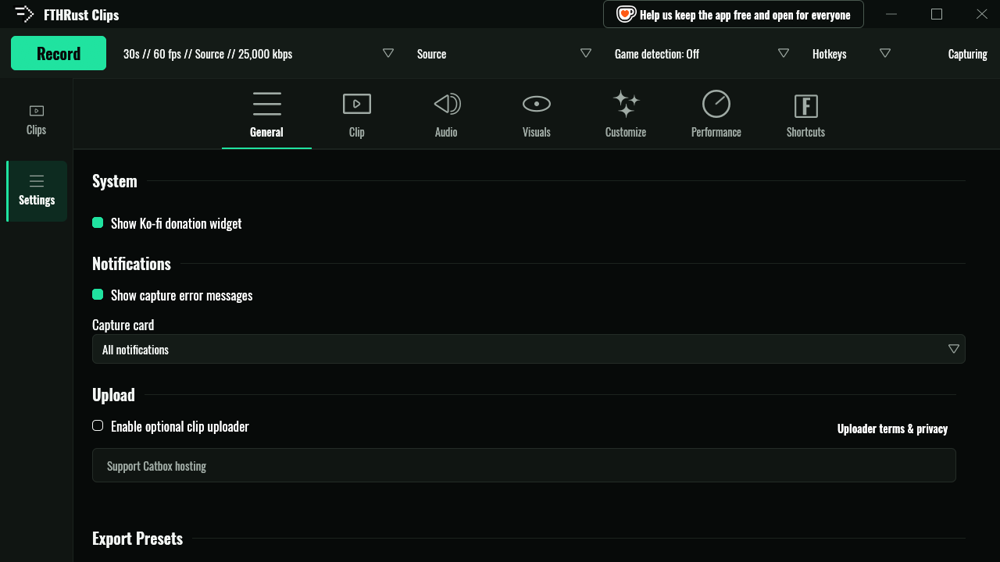

# Uploading

FTHRust can send clips to a host and hand you back a link. It's entirely optional and off by default. Until you turn it on, nothing in the app talks to the internet.

- [How it's kept separate](#how-its-kept-separate)
- [Turning it on](#turning-it-on)
- [Providers](#providers)
  - [Catbox](#catbox)
  - [Your server](#your-server)
  - [SFTP](#sftp)
- [When uploads happen](#when-uploads-happen)
- [Getting the link](#getting-the-link)
- [What's stored where](#whats-stored-where)
- [When an upload fails](#when-an-upload-fails)
- [The Your server protocol](#the-your-server-protocol)

## How it's kept separate

All upload code (HTTP, SFTP and the keyring) lives in its own program, `fthrust-uploader`. The app runs it once per upload, sends it a single request, and reads back a single answer. The main app and the capture engine never include any of that code, and CI fails the build if they ever start to. If you never enable uploads, that program never runs.

## Turning it on



1. Open **Settings → General → Upload** and tick **Enable optional clip uploader**.
2. Choose a **Provider**, fill in its fields, and press **Test connection**. Catbox asks you to accept its own policies first.
3. Press **Save upload settings**.

The **Uploader terms & privacy** link at the right of the checkbox opens the upload extension's Terms of Service and Privacy Policy. They apply while uploads are on; there is nothing to accept.

Upload settings carried over from FTHR Clips take effect at first launch, including interval uploads and auto-delete. Check the Upload section after upgrading.

## Providers

### Catbox

[Catbox](https://catbox.moe) is free, needs no account, and gives you a public `https://files.catbox.moe/…` link.

- The first time you choose it, FTHRust shows what Catbox stores (the file, its name and size, the upload time and your IP address) and asks you to accept Catbox's own terms.
- **User hash** is optional. Paste your Catbox account's userhash to have uploads show up in your account.
- Files are limited to **200 MB**. For bigger clips, FTHRust offers to compress a copy first; your original is never changed. Tick **Automatically compress oversized clips before upload** to skip the question.
- Anyone with the link can watch the clip, and it stays up until it's deleted.

Catbox is run by volunteers. **Support Catbox hosting** links to their donation page.

### Your server

Point FTHRust at your own HTTPS endpoint. It's made to pair with [FTHR Clips Server](https://github.com/kalopsia-space/fthr-clips-server), a self-hosted clip site with share pages that embed in Discord, but anything that speaks the [protocol below](#the-your-server-protocol) works.

| Field | Value |
|---|---|
| **Server URL** | The full upload URL, for example `https://clips.example.com/upload`. FTHRust posts to it exactly as written, so include the path. |
| **Auth header** | Sent as the `Authorization` header, word for word. For FTHR Clips Server: `Bearer <your upload token>`. |

**Test connection** checks the URL and token without uploading anything, and explains what's wrong if it fails: a missing path, a wrong token, nothing at that address.

There's no size limit on FTHRust's side. Your server may set one, and if it does, you'll be told the clip is too large for it.

### SFTP

Upload to any server you can reach over SFTP, such as a seedbox, a NAS or a web host.

| Field | Notes |
|---|---|
| **Host**, **Port**, **Username** | Port defaults to 22. |
| **Password** | Stored in your desktop keyring, never in a file. Leave it blank to keep the saved one. |
| **Remote folder** | `.` for your home folder, or a path like `/uploads`. |
| **Host key (optional)** | Paste the server's `SHA256:…` fingerprint to pin it. |
| **Public folder URL** | If that folder is also served over HTTPS, enter its URL and tick **Generate public HTTPS sharing links for SFTP uploads** to get web links. |

**Your password is never sent to a server FTHRust can't verify.** The server's key must match your pinned fingerprint, your `~/.ssh/known_hosts`, or a key FTHRust has verified before. Otherwise the connection stops before logging in and tells you how to trust the host. When a server has several host keys and you haven't pinned one, FTHRust asks for the type you already have on record for it (ECDSA, RSA or Ed25519), as `ssh` does, so an old `known_hosts` entry of any of them is enough. A pinned fingerprint decides on its own: `known_hosts` is not consulted for it and does not change which key is asked for. Only password logins are supported for now.

Files are uploaded as `fthr-<random>.mp4` under a temporary name (`fthr-<letters and digits>.part`), renamed when complete, and size-checked. A failed upload removes what it left on the server. If an upload is cut off with no chance to do that (the app stops an uploader that has gone 10 minutes without a word), the next upload of the same clip removes the leftover `.part` file (and writes under another name if the server won't let it go). **Forget saved password for this host and user** removes the password from the keyring.

**VaultScope** in the provider list is SFTP with VaultScope's settings filled in. **Paste VaultScope login** fills the fields from the login details VaultScope gives you.

## When uploads happen

**Auto Upload** decides when clips are sent:

- **Manual only (right-click a clip → Upload)**: the default. Nothing leaves your PC unless you ask.
- **Upload immediately after capture**: every saved clip is uploaded.
- **Upload on an interval**: new clips are collected and sent every few minutes, hours or days. Files changed in the last 30 seconds are left for the next round.

**Auto-delete local clip after a confirmed successful upload** removes your copy once a host has confirmed the upload **and** sent back a link FTHRust can use: an `http://` or `https://` address, or an SFTP location. If no link comes back, or the reply is something else (a word such as `queued`, a `file:` address, several lines of text), your clip is kept. It is kept too when the upload couldn't be saved to the upload history, because the history is where FTHRust finds a clip's link; the bar then shows the link instead.

The app does the deleting when the upload ends, by the same rules as the clip's **bin button**. A clip that an export or share is still working from is kept, whatever was started while the upload ran, and the bar says so (delete it yourself afterwards). A clip that is open in the editor is deleted and the editor closes with it, along with its saved draft. Switch auto-delete off while an upload runs and that clip is kept as well.

Auto-delete only ever removes clips inside your clips folder. Clips in folders you've imported are uploaded like any other (interval uploads include them) but are never deleted, even with the box ticked, so a whole imported library can't disappear by accident.

## Getting the link

When an upload finishes, a capture card shows **UPLOADED ORIGINAL** (or **UPLOADED COMPRESSED COPY**) and the clip gets an **Uploaded** badge. To get the link:

- click the clip's **share button** (*Copy link*), or
- right-click it and choose **Open uploaded link**.

The link isn't copied to your clipboard automatically.

If a server takes a clip but doesn't send a link back, the clip still gets the **Uploaded** badge, and the bar says there is no link to copy. Pressing **Upload clip** on such a clip shows *Already uploaded* on the card and says so again in the bar, which offers **UPLOAD AGAIN** to send it once more; in the editor, which has no bar, the **Upload** button reads *Upload again* for such a clip. The immediate and interval modes never upload it again. When the clip can't be deleted after an upload, is kept because an export or share is still using it, or the upload couldn't be saved to the history, the bar says that too. These notices hold a link or explain a button, so they show even when *Show capture error messages* is off.

## What's stored where

| What | Where |
|---|---|
| Uploader settings | `~/.fthr/uploader/settings.json` |
| SFTP passwords | Your desktop keyring (Secret Service), one entry per host and user |
| Catbox user hash, Your server auth header | `~/.fthr/uploader/settings.json`, **in plain text** |
| Upload history and links | `~/.fthr/uploader/upload_history.json` |
| SFTP host keys you've trusted | `~/.fthr/uploader/known_hosts` |

The `uploader` folder is private to you (`0700`) and the files in it are `0600`, since the settings hold the Catbox user hash and the Your server header in plain text. Older profiles are tightened the next time the app starts. If a file there can't be read, the app leaves it alone instead of replacing it with an empty one, and a file that isn't valid JSON is copied to `<name>.corrupt` before anything is written over it.

The uploader only reads clips inside your clips folder and folders you've imported. It refuses any other path it's given.

## When an upload fails

A failed upload shows **UPLOAD FAILED** in the bar at the bottom, with the reason in plain words and a **RETRY NOW** button. If the problem is your settings (a wrong URL or token), there's an **OPEN UPLOAD SETTINGS** button too. Renaming or deleting the clip dismisses its **RETRY NOW** and **UPLOAD AGAIN** notices, since their buttons would name a file that is no longer there; upload from the clip's card instead.

Network errors, rate limits and server errors on Catbox and Your server are retried automatically three times, after 5, 15 and 45 seconds. SFTP uploads aren't retried.

An HTTP upload is never cut off for taking long: only for going quiet. It fails when no data goes out for 2 minutes, or when the server hasn't answered 2 minutes after the whole clip was sent, and that counts as a network error. The app doesn't cap the time either: while data moves, the uploader reports its progress every 10 seconds or so (HTTP and SFTP alike), and the app stops it only after 10 minutes without a word, so a big clip on a slow connection takes as long as it takes. A failure after an upload has been running for about 9 minutes isn't retried on its own; use **RETRY NOW**.

[Troubleshooting](troubleshooting.md) lists every upload error code.

## The Your server protocol

For anyone writing a server, or debugging one.

**Upload**

```http
POST <Server URL exactly as configured>
Authorization: <Auth header, verbatim, if set>
User-Agent: FTHR-Clips/Desktop-Uploader
Content-Type: multipart/form-data; boundary=…
Content-Length: <exact length>

one file field named "clip", with the clip's file name and content type
```

- A URL without a scheme gets `https://`. Only `http` and `https` are allowed.
- Redirects are **not** followed. A 3xx response is reported as an error; point the URL at the final address.
- Any 2xx response is a success. If the body is JSON with a `url` (or `raw_url`) field, or is plain text starting with `http://` or `https://`, that's the link, provided it is a single-line `http://` or `https://` address. Otherwise (no link, or something else such as `queued`) the upload counts as done without a link, the bar says so, and auto-delete is skipped.
- On an error, an `error`, `message` or `detail` field in a JSON body (or a short plain-text body) is shown to the user, up to 400 characters. HTML error pages are not shown.

**Test connection** sends `HEAD <Server URL>` with the same `Authorization` header. A 2xx answer, or a 405 from a server that doesn't support `HEAD`, counts as reachable.
